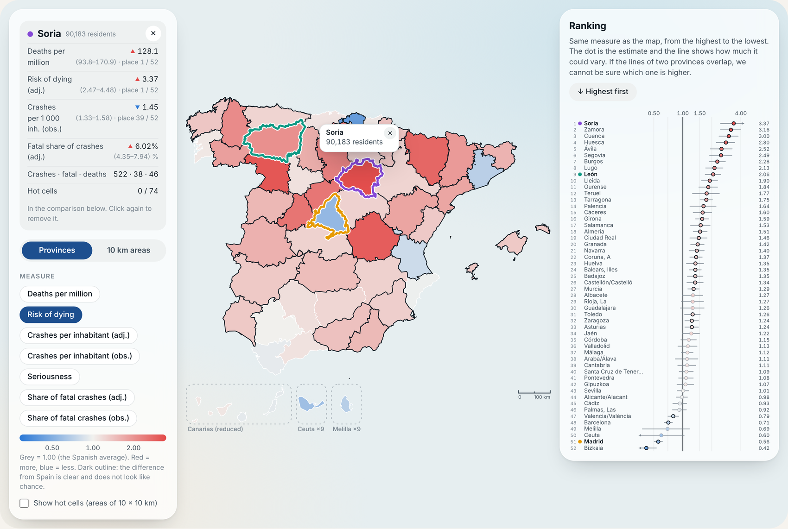
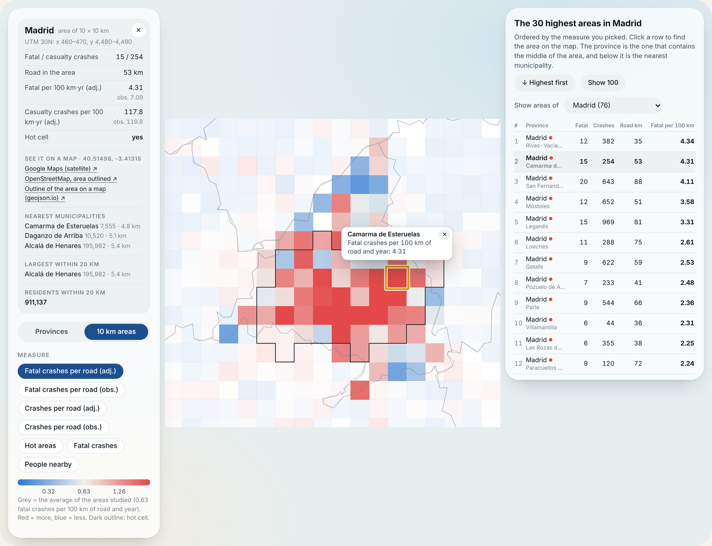

# road-risk-atlas-spain

**Interactive atlas of road crash risk in Spain** (provinces and 10 × 10 km areas), 2022–2025. Spanish and English.

### → [Open the atlas](https://MMH1997.github.io/road-risk-atlas-spain/)

  
  

## What it shows

- **Province view.** The 52 provincial units coloured by one of seven measures (deaths per million inhabitants, risk of dying, crashes per inhabitant, seriousness of the crashes, share of fatal crashes, corrected for small numbers or as recorded). Click up to three provinces to compare them; the ranking carries the interval of every estimate.
- **Area view.** Cells of 10 × 10 km coloured by seven measures (fatal crashes and casualty crashes per 100 km of road and year, corrected or as recorded; hot areas; number of fatal crashes; people nearby). It ranks the highest areas, names the nearest municipalities and links each cell to a map.
- The page can be used on a phone, and a particular view can be shared as a link: the selection is stored in the address.

The atlas shows **aggregates only**: the finest detail is the count of a 10 km cell. No individual crash is included.

## How to read it with care

Rates are per inhabitant or per kilometre of road, not per kilometre driven. Hot areas describe where fatal crashes cluster in four years of data and are a guide to where to look, not a diagnosis of causes. See the paper for the methods and their limits.

## Files

`index.html` is the whole atlas: one self-contained file with its data, code and maps. It needs no server and no database; only two web fonts and the map links of the cells use the network. To run it locally, download `index.html` and open it in a browser.

The code and data preparation are in the analysis repository (to be made public with the paper).

## Sources

- Crash records: Spanish traffic authority (DGT), annual microdata 2022–2025.
- Population: INE, table 67988 (resident population by province).
- Administrative boundaries: IGN/CNIG, simplified (CC BY 4.0).
- Municipal names, positions and population (1 January 2021): open INE/CNIG-based database.

The estimates come from the paper that accompanies this page and are not official statistics.

## Authors

Manuel Méndez, Mercedes G. Merayo and Manuel Núñez. Design and Testing of Reliable Systems Research Group, Complutense University of Madrid.

Research partially supported by the State Research Agency (AEI) of the Spanish Ministry of Science and Innovation under grants PID2021-122215NB-C31 and PID2021-122215NB-C32 (AwESOMe), and by the Comunidad de Madrid under grant TEC-2024/COM-235 (DESAFíO-CM).

## License

To be decided. Until then, all rights are reserved by the authors.
